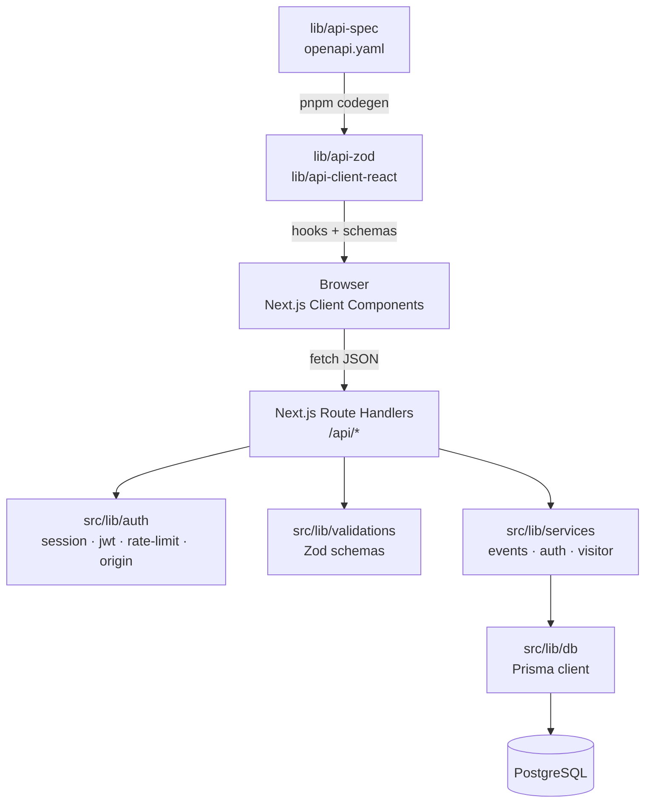

# Interviewer Guide — Civic Community Events Board

A practical walkthrough of what was built, why, and what was traded away. Every claim
here matches the code in this repository; nothing is aspirational.

---

## 1. Overview and problem

Civic is a small community events board. Visitors browse and filter a public catalogue,
save favourite categories to get a personalised feed, set reminders on events, and
design a personal event card. One administrator manages the catalogue.

The interesting part is not the feature list — it is that every feature goes through the
application's own JSON API, and the same contract is the one a future mobile client would
use. There is no direct database access from the browser and no separate mock backend.

## 2. Architecture



Request flow for a mutation, for example saving a reminder:

1. A Client Component calls a generated hook from `@workspace/api-client-react`.
2. TanStack Query issues `PUT /api/events/[id]/reminder` with the session cookie.
3. The Route Handler calls `assertOrigin` (CSRF), then `requireUser` (authorization).
4. `readJson`/`idSchema` validate input.
5. A service function performs the database work.
6. `eventDto` shapes the response; `json()` adds `Cache-Control: no-store`.

## 3. Folder structure and responsibilities

| Path | Responsibility |
|---|---|
| `src/app/` | Pages, layouts and Route Handlers |
| `src/components/` | UI: feature components, `ui/` shadcn primitives |
| `src/lib/auth/` | Password hashing, JWT, session resolution, CSRF, rate limiting |
| `src/lib/db/` | Singleton Prisma client |
| `src/lib/services/` | Business logic and database access, no HTTP concerns |
| `src/lib/validations/` | Zod schemas, the single validation boundary |
| `src/lib/http.ts` | Error mapping, response shaping, body reading |
| `prisma/` | Schema, migrations, seed |
| `tests/` | Vitest unit tests |
| `e2e/` | Playwright browser tests |

## 4. Database schema and relationships

Five entities, all relational, with no denormalised counters:

- **User** — visitor accounts. `email` is unique and normalised to lowercase.
- **Event** — the catalogue. `price` is `Decimal(10,2)` to avoid float drift.
  `isActive` controls public visibility.
- **FavouriteCategory** — join table, composite primary key `(userId, category)`.
- **EventReminder** — join table, composite primary key `(userId, eventId)`.
- **EventCardDesign** — join table, composite primary key `(userId, eventId)`,
  with `stickers` as a PostgreSQL `String[]`.

Why relational: every one of these is a relationship with its own attributes and an
independent lifetime. The composite primary keys do the real work — they make duplicate
preferences and duplicate reminders impossible at the database level rather than in
application code. `onDelete: Cascade` means deleting a user cleans up their preferences,
reminders and designs without a second query.

Indexes on `Event` are `(isActive, startsAt, id)` and `(category, isActive, startsAt)`,
chosen to match the public listing's filter-then-sort order.

## 5. Example queries

Combined filtering, in `src/lib/services/events.ts`:

```ts
export function publicWhere(query, now, categories) {
  return {
    isActive: true, startsAt: { gt: now },
    ...(query.category ? { category: query.category }
      : categories ? { category: { in: categories } } : {}),
    ...(query.city ? { city: { equals: query.city, mode: "insensitive" } } : {}),
    ...(query.search ? { OR: [
      { title: { contains: query.search, mode: "insensitive" } },
      { description: { contains: query.search, mode: "insensitive" } },
      { city: { contains: query.search, mode: "insensitive" } },
    ] } : {}),
  };
}
```

Filtering happens in SQL, never in JavaScript. The listing reads:

```ts
db.event.findMany({
  where,
  orderBy: [{ startsAt: "asc" }, { id: "asc" }],
  skip: (query.page - 1) * query.pageSize,
  take: query.pageSize,
})
```

The personalised feed reuses `publicWhere` with the user's saved categories substituted
for an explicit one, so feed and discovery cannot drift apart.

## 6. Pagination, sorting and indexing trade-offs

Sorting is `startsAt asc, id asc`. The `id` tiebreaker matters: without a unique
tiebreaker, two events starting at the same instant can swap places between pages and
a visitor can see one twice and never see another. This is asserted in the browser tests.

`listEvents` runs the page query and the count inside one transaction at
`RepeatableRead`, so the returned rows and the total cannot disagree.

Indexing: `(isActive, startsAt, id)` serves the default listing and its sort. The
category index helps when a category is supplied.

**Honest limitation:** the text search uses `ILIKE '%term%'`. A B-tree index does not
accelerate a leading-wildcard substring match. `pg_trgm` with a GIN index would help,
and was deliberately left out because it adds a migration and an extension dependency for
a dataset that is small. This is a real limitation, not an oversight, and it is the first
thing I would change with a larger corpus.

## 7. Signup, login, hashing, JWT and cookies

Signup and login both validate through `credentialsSchema`, which normalises the email
and enforces a 10–72 byte password. The byte check matters: bcrypt ignores input past 72
bytes, so a longer password must be rejected rather than silently truncated.

`authenticate` looks up the user and compares with bcrypt. When no account exists it
still compares against a precomputed dummy hash, so a missing account and a wrong
password take comparable time and the error is identical: `Invalid email or password.`

A JWT is signed with HS256 using `jose`, carrying `sub`, `email`, `role`, `iss`, `aud`,
`iat` and `exp`, with an 8-hour lifetime. Verification pins the algorithm, issuer and
audience, and requires all claims.

Login returns the token in the JSON body, as the assessment requires, and also sets an
`HttpOnly`, `SameSite=Lax` cookie, `Secure` in production. The token is never placed in
`localStorage` or `sessionStorage`; a browser test asserts this directly.

### The credential-loading trap worth discussing

A bcrypt hash starts with `$2b$12$`. Next.js expands `$name` references while loading
`.env`, and in this project it stripped those leading segments, leaving a value that
failed the cost-factor guard — every admin login returned `503 ADMIN_CONFIG`. Quoting
the value does not help, and escaping with `\$` does not either, because the backslashes
survive loading and the guard still rejects the value.

The fix is to supply `ADMIN_EMAIL` and `ADMIN_PASSWORD_HASH` through the real process
environment rather than `.env`. This is the single most useful thing to raise in an
interview: the failure was silent, produced a plausible-looking error, and would have
shipped broken.

## 8. Admin authorization

Every protected handler calls `requireAdmin` or `requireUser` server-side. No middleware
is involved in the authorization decision.

Middleware or a layout guard would only be a navigation convenience. Hiding a link, or
redirecting in a layout, changes nothing about what the API will accept — a signed-in
visitor can always call `POST /api/admin/events` by hand. That is exactly what the browser
tests attempt, and the server answers `403`.

The admin account itself is environment-provisioned with no database row. Unsetting either
variable disables admin login entirely, which is a safe default.

An admin token is re-verified on every request against `ADMIN_EMAIL` and
`ADMIN_PASSWORD_HASH`, so removing either variable invalidates live sessions rather than
only new ones.

## 9. Reminders: optimistic update, persistence, rollback

`useReminderToggle` keeps a map of per-event overrides:

1. Read initial state from the API (`hasReminder` on each event).
2. Apply the override immediately, so the button responds on click.
3. Send `PUT` or `DELETE`.
4. On success, adopt the server's `hasReminder` and invalidate the affected queries.
5. On failure, drop the override so the previous state reappears, and raise a toast.
6. An `inflight` set blocks a second operation for the same event while one is pending.

Step 6 is the part that is easy to miss: without it, a double-click could interleave a
save and a remove and leave the two out of step with the server.

Persistence is verified by a browser test that reloads the page.

## 10. Card design and the three-sticker rule

Themes and stickers are typed allowlists in `src/lib/validations/index.ts`. The client
disables extra sticker buttons at three, but that is a convenience only — the server
rejects a fourth sticker with `422` regardless of what the client sent, which is asserted
directly against the API.

Designs are keyed by `(userId, eventId)`, and the user always comes from the verified
session. A request body cannot name a different owner.

## 11. Loading, empty, error and responsive decisions

Every list has three states: a skeleton while loading, an `EmptyState` with a route out
when there is nothing to show, and a `FormAlert` with a retry on failure. A silent blank
screen would be indistinguishable from a slow page.

Dates render in `Asia/Kolkata` and prices with `Intl.NumberFormat('en-IN')`. Times are
stored in UTC as `timestamptz`; the display timezone is a presentation choice, not a
storage one.

Responsive behaviour is covered by Playwright at 320, 375 and 390 pixels, asserting no
horizontal overflow, and that navigation collapses behind a menu.

## 12. Testing strategy and edge cases

109 unit tests (`pnpm test`) and 89 browser tests (`pnpm test:e2e`), all verified passing.

Unit tests cover validation bounds, JWT forgery and expiry, CSRF origin decisions, rate
limiting, event filter composition, DTO field exposure, and request body limits. Two are
worth calling out: one asserts the generic 500 path never leaks internal error text or a
connection string, and one asserts no DTO contains a password hash.

Browser tests run against a dedicated `civic_test` database and a separate port, so they
cannot touch development data.

Edge cases deliberately covered: an inactive event is invisible publicly but still
present for admins; a past event never appears; combining filters that cannot both match
returns an empty list rather than ignoring one; a reminder for an unknown or ineligible
event returns `404`; repeated reminder writes are idempotent; a stale `updatedAt` is
rejected with `409` rather than silently overwriting another admin's edit; a tampered or
forged token is refused.

## 13. Environment, setup and troubleshooting

| Variable | Purpose |
|---|---|
| `DATABASE_URL` | PostgreSQL connection string |
| `JWT_SECRET` | Signing secret, at least 32 bytes |
| `ADMIN_EMAIL` | Admin login address |
| `ADMIN_PASSWORD_HASH` | bcrypt hash, cost 12 or higher |
| `AUTH_TRUSTED_IP_HEADER` | Optional; enables per-peer rate limiting |

Setup and seeding are documented in the README. Migrations and seeding never run at
application startup or build time.

Common problems and what they mean:

- **Admin login returns 503** — the hash did not arrive intact. Almost always the `.env`
  expansion problem above.
- **Login returns 401 for a correct password** — the hash and plaintext do not match, or
  `.env` shadows the exported variable.
- **`pnpm install` fails with a native binding error** — a stale build directory; delete
  the app's `.next*` folder and reinstall.

## 14. Security limitations and next improvements

- **Rate limiting is in-process.** Correct for one instance, ineffective behind a load
  balancer. A shared store is the first thing I would add.
- **No email verification or password reset.** Both are out of scope for the assessment,
  and both are prerequisites for a real deployment.
- **No audit log** for admin actions. Worth adding before an admin can retire events.
- **No upload handling.** `imageUrl` is validated as a public HTTP(S) URL and rendered in
  an ``; there is no proxying or content sniffing, so a remote host is trusted to
  serve an image.
- **Substring search is not indexed** without `pg_trgm`, as described above.
- **Sessions are not revocable.** A JWT is valid until it expires unless the admin
  variables change. A denylist would cost a lookup on every request.

## 15. Likely interview questions

**Why not a separate API server?**
The brief required a single Next.js application, and it removes a deployment boundary.
The cost is that route handlers share the framework's runtime; I would not choose it for
a larger surface area.

**Why generate the client from OpenAPI?**
It turns contract drift into a build-time diff instead of a runtime bug. The cost is a
codegen step that must run before typecheck whenever the spec changes.

**Why re-verify the JWT on every request?**
So that deleting an account or removing the admin variables takes effect immediately
rather than at token expiry. The cost is one indexed read per authenticated request.

**How do you prevent a visitor becoming admin?**
They cannot. Role is derived from the verified token and, for admin, re-checked against
the environment. Client-supplied `role` is rejected by a strict schema, and the browser
tests assert `403` when a visitor calls admin APIs by hand.

**Why same-origin checks instead of CSRF tokens?**
`SameSite=Lax` already blocks cross-site form posts, and an `Origin` check closes the
remainder with no extra client state. The trade-off is that proxies must forward `Host`
correctly, and bearer clients must still send `Origin` for mutations.

**What would you do differently?**
Move rate limiting to a shared store, add an audit trail for admin edits, and generate
the initial Prisma client during `postinstall` rather than as an explicit step.

---

## AI usage disclosure

This project was developed with AI assistance for scaffolding, implementation, debugging
and test authoring. Requirements, architecture decisions and trade-offs were mine. Every
change was reviewed and verified locally: `pnpm typecheck`, `pnpm lint`, `pnpm test`,
`pnpm build` and `pnpm test:e2e` all pass, and the application was exercised against a
local PostgreSQL instance.

No performance metrics, traffic figures, or production claims are made anywhere in this
document. Features that are not implemented are listed as limitations rather than
described as working.